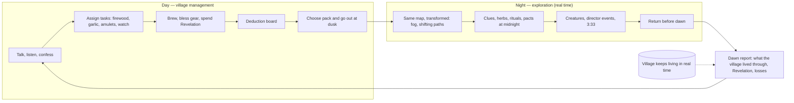
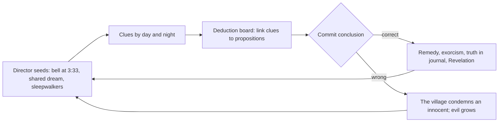
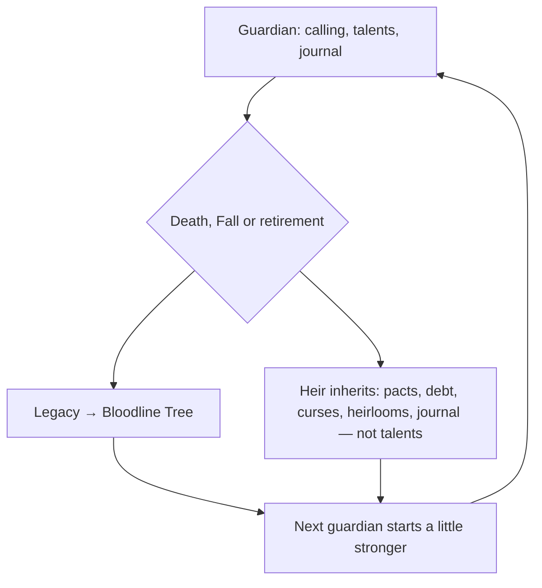

# MRAK — Game Design Document

Status: v0.1 · 2026-11-15 · **Source of truth.** Details live in the linked documents; when a
number conflicts, [progression-economy](systems/progression-economy.md) wins.

---

## 1. Vision

> _In the Rhodope village of Mrak, every misfortune has a price — and someone else is collecting._

MRAK is a 2D browser horror RPG. By **day** you hold a cursed, poor village together; by
**night** you walk the same land transformed, carrying a lantern that is both your life and your
only weapon. The village of Mrak suffers while neighbouring **Zlatno** inexplicably prospers.
Finding out why — and what you are willing to do about it — takes generations.

- **Setting:** Rhodope Mountains, Bulgaria, 1834–1878 (Ottoman rule, Bulgarian National Revival).
  Real Bulgarian folklore is the foundation; invented parts are marked as invented. → [timeline](lore/timeline.md)
- **Hidden truth:** in 1779 an innocent herb-woman, Stana, was burned as a witch. The real pact
  was signed by Zlatno's founder with the Horned One: Zlatno's prosperity, paid by Mrak. His
  bloodline renews it every generation. Stana's spirit remains in the forest. Under the mine
  sleeps something older than all of them: the **Thracian Horseman**.
  → [zlatno-bloodline](lore/zlatno-bloodline.md) · [guardian-bloodline](lore/guardian-bloodline.md)

## 2. Pillars

1. **Dread, not cheap jump scares.** Pacing by the [event director](systems/event-director.md); quiet after every peak.
2. **Every decision leaves a permanent scar.** Deaths are permanent, zones change state, the village remembers.
3. **Continuous growth.** Guardian (attributes, skills by use, talent trees bought with
   Revelation from milestones — never from killing), village (buildings, population,
   reputation), bloodline (Bloodline Tree). Never sold for money.
4. **Real, mystery or hallucination — you never know.** [sanity](systems/sanity.md), [event director](systems/event-director.md).
5. **Longevity through systems, not filler.** Generations, routes, Endless Chronicle, seasonal events.
6. **The UI is clear and friendly even when the world is not.** Icons, tooltips, readable fonts, no hidden controls.

## 3. Audience

- **Primary:** players of narrative horror and management/roguelite hybrids (18+), who enjoy
  folklore, investigation and consequences; PC browser players looking for a substantial game
  without installation.
- **Secondary:** Bulgarian and Balkan players interested in their folklore treated seriously;
  folk-horror fans (TTRPG players who like careers, talent trees and obligations).
- **Rating target:** Mature (horror, violence, religious themes, no sexual content).
- **Session length:** 20–60 minutes (one or a few day/night cycles); saves at dawn and dusk.

## 4. References (inspiration, never copied)

| Reference                              | What we take                                                             | What we avoid                         |
| -------------------------------------- | ------------------------------------------------------------------------ | ------------------------------------- |
| Cult of the Lamb                       | Management + action loop, a community that depends on you                | Its tone, art and cult mechanics      |
| Fear Street: 1666                      | Generational pact, witch hunt, inverted truth (thematic)                 | Any plot, characters or structure     |
| Hereditary / The Exorcist              | Slow demonic dread, family as horror                                     | Explicit gore for its own sake        |
| Edge-of-the-Empire-style tabletop RPGs | Careers, specialization trees bought with XP, obligation, dual-axis dice | Their rules text, dice symbols, names |
| Bulgarian folklore & ethnography       | Creatures, rites, calendar, songs                                        | Inventing "real" folklore             |

## 5. Core loops

### 5.1 Day ↔ Night

### 5.2 Mystery loop

### 5.3 Generational loop

Specs: [time-calendar](systems/time-calendar.md) · [villagers](systems/villagers.md) ·
[tasks](systems/tasks.md) · [night-exploration](systems/night-exploration.md) ·
[mysteries](systems/mysteries.md) · [lineage](systems/lineage.md).

## 6. Map

Semi-open and handcrafted. Every zone has state variants (allied, hostile, burned, flooded, consecrated…).

| Zone                                                          | Role                                       | MVP  |
| ------------------------------------------------------------- | ------------------------------------------ | ---- |
| **Village of Mrak** (church, tavern, houses, mill, cemetery)  | Hub, day management, night defence         | ✅   |
| **Samodivi Forest** (incl. the crossroads at its edge in MVP) | Herbs, forest spirit, samodivi, pacts      | ✅   |
| **Ruined Monastery** of St. Elijah                            | Grimoire pages, seals, relics              | ✅   |
| The Crossroads (full zone)                                    | Pacts at midnight, the Stranger            | full |
| Abandoned Mine                                                | Kopach, the Horseman's seal, bones of Mrak | full |
| Lake of the Drowned                                           | Mamnik's domain, the drowned               | full |
| Zlatno                                                        | Rival village, the Pact's ledger           | full |
| Thracian fortress                                             | Final area, the Horseman                   | full |

## 7. Dark forces

- **Demons and possession (core):** lesser besove → 9 named demons → the Horned One. Each with true name, seal, symptoms, weaknesses, desires. → [demons](lore/demons.md) · [possession](systems/possession.md) · [exorcism](systems/exorcism.md)
- **The forest spirit ("the witch"):** a dangerous ally who asks for memories, names, intimate
  things; can pull down the moon. → [light](systems/light.md) · [sacrifices](systems/sacrifices.md)
- **The Horned One:** pacts at the crossroads at midnight, hidden clauses. → [pacts](systems/pacts.md) · [debt](systems/debt.md)
- **Bestiary** (vampires, karakondzhuli…): texture, not core. → [bestiary](lore/bestiary.md)
- The forces hate each other and can be played against each other.

## 8. Progression (summary)

Full plan: **[progression-economy](systems/progression-economy.md)**.

| Layer                                                         | Grows by                                      | Spec                                                                      |
| ------------------------------------------------------------- | --------------------------------------------- | ------------------------------------------------------------------------- |
| Attributes (Vigor, Agility, Wits, Cunning, Resolve, Presence) | Revelation                                    | [attributes](systems/attributes.md)                                       |
| Skills (17)                                                   | **Use**; caps raised with Revelation          | [skills](systems/skills.md)                                               |
| Calling (6)                                                   | Chosen per guardian                           | [callings](systems/callings.md) · [lore](lore/callings.md)                |
| Talent trees (12 + 2 dark)                                    | Revelation                                    | [talents](systems/talents.md) · [trees](lore/talent-trees.md)             |
| Revelation (XP)                                               | Milestones only                               | [revelation-xp](systems/revelation-xp.md)                                 |
| Debt                                                          | Pacts, dark favours                           | [debt](systems/debt.md)                                                   |
| Virtue & Sin                                                  | Choices; Faith ↔ Corruption                   | [virtue-sin](systems/virtue-sin.md) · [corruption](systems/corruption.md) |
| Gear & blessings                                              | Crafting, rites                               | [gear-blessings](systems/gear-blessings.md)                               |
| Omens (check resolution)                                      | —                                             | [omens](systems/omens.md)                                                 |
| Journal & forbidden knowledge                                 | Discovery; the only inheritance of knowledge  | [journal](systems/journal.md)                                             |
| Village                                                       | Buildings, population, prosperity, reputation | [village-growth](systems/village-growth.md)                               |
| Bloodline Tree                                                | Legacy per generation (account-level)         | [bloodline-tree](systems/bloodline-tree.md)                               |
| Endless Chronicle                                             | Darkness levels, relic talents                | [endless-chronicle](systems/endless-chronicle.md)                         |

## 9. Resource economy

| Resource                               | Sources                                    | Sinks                                    | Tension                                                       |
| -------------------------------------- | ------------------------------------------ | ---------------------------------------- | ------------------------------------------------------------- |
| **Light** (oil, candles, wax)          | Chapel allocation, trade, rendering tallow | Lantern (1/15 min), light bursts, vigils | A winter night needs ~42 oil; a standard allocation gives 20. |
| **Food** (bread, flour, stores)        | Mill, baking, hunting, trade               | 1 per villager/day; offerings            | Shortage → fear and sickness.                                 |
| **Firewood**                           | Firewood task                              | 2 per house/day in winter; building      | Cold houses → health loss.                                    |
| **Sanity** (guardian) / village sanity | Rest, services, tea, virtue                | Darkness, sightings, possession          | Low sanity → hallucinations and hysteria.                     |
| **Faith / Corruption**                 | Rites / dark power                         | —                                        | Dominance changes who chooses your words.                     |
| **Silver (grosh)**                     | Trade, Zlatno loans, haiduti               | Taxes to the aga, building, trade        | Loans from Zlatno add leverage over Mrak.                     |
| **Revelation**                         | Milestones                                 | Talents, attributes, skill caps          | Every guardian is a build.                                    |
| **Debt**                               | Pacts, favours                             | Payment, route events                    | Power now, collection later.                                  |
| **Legacy**                             | Generation end                             | Bloodline Tree                           | Slow, permanent.                                              |

Detail: [inventory](systems/inventory.md) · [tasks](systems/tasks.md) · [alchemy](systems/alchemy.md) · [light](systems/light.md) · [sanity](systems/sanity.md) · [hysteria](systems/hysteria.md).

## 10. Chapter structure

A guardian's year follows the **folk calendar**; each festival is a chapter. → [festivals](lore/festivals.md)

| #   | Chapter                             | Nights          | Signature                                              |
| --- | ----------------------------------- | --------------- | ------------------------------------------------------ |
| P   | **Prologue (1779)** — play as Stana | 1 day + 1 night | The pact witnessed; the burning                        |
| 1   | The Unclean Days                    | 12              | Karakondzhuli, koledari, M1 _The Wasting Bride_        |
| 2   | Kukeri                              | 7               | Masks hide you from demons; hidden possessions surface |
| 3   | Nestinari                           | 5               | Fire, Ognitsa, the pyre's memory                       |
| 4   | Rusalia Week                        | 7               | The forest spirit at her strongest                     |
| 5   | Enyovden                            | 5               | Herbs ×2; the Zlatevi renew the Pact                   |
| 6   | Zadushnitsa                         | 7               | The dead speak; M2 _The Empty Graves_                  |

Between years: **time-skips** (1–10 years) with historical anchors (1839, 1856, 1870, 1876).
Other systems: [event-director](systems/event-director.md) · [quests](systems/quests.md) ·
[dialogue](systems/dialogue.md) · [hysteria](systems/hysteria.md) · [sacrifices](systems/sacrifices.md) ·
[combat](systems/combat.md) · [world-state](systems/world-state.md).

## 11. Routes and endings

The route choice opens after M3 _The Golden Harvest_ ([mysteries](lore/mysteries.md)).

| Route                                               | Act                                                                | Ending (sketch)                                                        | Cost                                                       |
| --------------------------------------------------- | ------------------------------------------------------------------ | ---------------------------------------------------------------------- | ---------------------------------------------------------- |
| **Expose the pact**                                 | Prove it to both villages and the authorities                      | Zlatno's house falls; the curse remains unbroken                       | Violence between villages; the aga's intervention          |
| **Break the pact**                                  | Find the founder's ledger, the relic, the place; pay the price     | Both villages become ordinary — poor and free                          | A guardian's life (or a beloved villager's)                |
| **Steal the pact**                                  | Make an unbelieving Zlatev heir renew it (hidden clause)           | Mrak prospers, Zlatno is cursed                                        | You become what Dragan was                                 |
| **Ally with the forest**                            | Bride of the Forest; Stana's vengeance                             | Zlatno's bloodline is destroyed; the forest swallows the road          | Your guardian becomes hers                                 |
| **Serve the Horned One**                            | Servant tree; take over the Pact                                   | You rule both villages' fortunes                                       | The bloodline is his                                       |
| **Pure route** (only one revealing the whole truth) | No dark trees, no lynchings, Stana's name, the Horseman understood | Stana is laid to rest; the Horseman rides out once and the powers flee | Hardest; requires several generations of journal knowledge |

**The Cycle** (narrative NG+): after an ending, return to 1834 with the Bloodline Tree and echoes —
some characters remember. Target **30–40 h per route, 100+ h total**.

## 12. Product: demo vs full game

Browser-first, English. Achievements and cloud saves need an account; guests play the demo
with local saves. Business model details: [business](business/README.md).

|              | **Free demo**                                                | **Full game (paid)**             |
| ------------ | ------------------------------------------------------------ | -------------------------------- |
| Content      | Prologue + Unclean Days nights 1–4                           | Everything below                 |
| Callings     | Priest's Acolyte, Znaharka                                   | All 6                            |
| Trees        | Exorcist, Confessor, Folk Healer, Charm-Speaker (T1–T2 only) | All trees, all tiers, dark trees |
| Zones        | Village, Samodivi Forest                                     | All 8 zones                      |
| Saves        | Local (guest) or cloud (account)                             | Cloud + local                    |
| Achievements | Demo-flagged only (carry over)                               | All                              |
| Carry-over   | Demo save and Bloodline progress continue in the full game   | —                                |

Paid content is never shipped to clients without an entitlement ([seasonal-events](systems/seasonal-events.md), [save-system](systems/save-system.md), [achievements](systems/achievements.md)).

## 13. MVP scope (vertical slice) vs full vision

### MVP — explicitly in scope

- **One winter:** The Unclean Days, **12 nights**, one generation (1834–35).
- **Zones:** Village, Samodivi Forest (with crossroads edge), Monastery ruins.
- **8 villagers:** [villagers-mvp](lore/villagers-mvp.md).
- **3 demons/creatures:** Mamnik, lesser besove, karakondzhul (+ folk events: mora, navi, fevers, samodivi circles).
- **1 mystery:** M1 _The Wasting Bride_.
- **2 routes (MVP-scale endings):** _Save the bride_ (truth: Dimo and Zlatno's coin; first evidence
  of the Pact) and _The village's verdict_ (wrong accusation — the 1779 echo). Both close the
  chapter with a different village state and journal.
- **Short prologue** (Stana, 1779).
- **15 achievements:** [achievements](systems/achievements.md).
- **2 callings** (Priest's Acolyte, Znaharka), **2 specialization trees each** + **1 dark tree** (Servant of the Horned One).
- **Debt, omens**, virtue & sin, sanity, hysteria, possession & exorcism, pacts, light, basic combat.
- **3 village buildings:** chapel, herbalist's hut, watchtower.
- **Bloodline Tree Tier 1.**
- Saves: local + cloud.

### MVP — explicitly out of scope

Other 4 callings and their trees · Bride of the Forest · chapters 2–6 · M2, M3 · zones Crossroads
(full), Mine, Lake, Zlatno, Fortress · heirs and time-skips (death ends the chronicle) ·
Endless Chronicle · seasonal live events (stub only) · Bloodline Tiers 2–5 · daguerreotypes.

### Full vision

All of the above plus 6 chapters per year across ~3 generations (1834–1878), 6 routes, The Cycle,
Endless Chronicle with Darkness 1–10, seasonal packs, 9 named demons, full bestiary, 6 callings, 14 trees.

## 14. Document map

**Lore:** [timeline](lore/timeline.md) · [zlatno-bloodline](lore/zlatno-bloodline.md) ·
[guardian-bloodline](lore/guardian-bloodline.md) · [demons](lore/demons.md) ·
[bestiary](lore/bestiary.md) · [villagers-mvp](lore/villagers-mvp.md) · [festivals](lore/festivals.md) ·
[mysteries](lore/mysteries.md) · [glossary](lore/glossary.md) · [callings](lore/callings.md) ·
[talent-trees](lore/talent-trees.md)

**Systems** ([index](systems/README.md)): [world-state](systems/world-state.md) ·
[time-calendar](systems/time-calendar.md) · [villagers](systems/villagers.md) · [tasks](systems/tasks.md) ·
[inventory](systems/inventory.md) · [alchemy](systems/alchemy.md) · [skills](systems/skills.md) ·
[attributes](systems/attributes.md) · [callings](systems/callings.md) · [talents](systems/talents.md) ·
[revelation-xp](systems/revelation-xp.md) · [debt](systems/debt.md) · [virtue-sin](systems/virtue-sin.md) ·
[omens](systems/omens.md) · [gear-blessings](systems/gear-blessings.md) · [journal](systems/journal.md) ·
[dialogue](systems/dialogue.md) · [quests](systems/quests.md) · [sanity](systems/sanity.md) ·
[hysteria](systems/hysteria.md) · [event-director](systems/event-director.md) ·
[possession](systems/possession.md) · [exorcism](systems/exorcism.md) · [pacts](systems/pacts.md) ·
[corruption](systems/corruption.md) · [sacrifices](systems/sacrifices.md) · [mysteries](systems/mysteries.md) ·
[night-exploration](systems/night-exploration.md) · [combat](systems/combat.md) · [light](systems/light.md) ·
[village-growth](systems/village-growth.md) · [lineage](systems/lineage.md) ·
[bloodline-tree](systems/bloodline-tree.md) · [endless-chronicle](systems/endless-chronicle.md) ·
[seasonal-events](systems/seasonal-events.md) · [save-system](systems/save-system.md) ·
[achievements](systems/achievements.md) · [progression-economy](systems/progression-economy.md) ·
[content-model](systems/content-model.md) · [conditions-effects](systems/conditions-effects.md) ·
[game-app](systems/game-app.md) · [asset-pipeline](systems/asset-pipeline.md)

**Style:** [writing-style](writing-style.md)

**ADRs:** [0001 Phaser + React, browser-first](adr/0001-phaser-react-browser.md) ·
[0002 Content as data](adr/0002-content-as-data.md) · [0003 Ink dialogue](adr/0003-ink-dialogue.md) ·
[0004 Pure core](adr/0004-pure-core.md) · [0005 Monorepo tooling](adr/0005-monorepo-tooling.md) ·
[0007 Tokens](adr/0007-tokens.md) · [0008 Cloudflare edge](adr/0008-cloudflare-edge.md) ·
[0009 Guest and account](adr/0009-guest-and-account.md) ·
[0010 Payments provider](adr/0010-payments-provider.md)

**Security:** [threat model](security/threat-model.md) · [ASVS L2](security/asvs-checklist.md) ·
[API Top 10](security/api-top10.md) · [data inventory](security/data-inventory.md)
