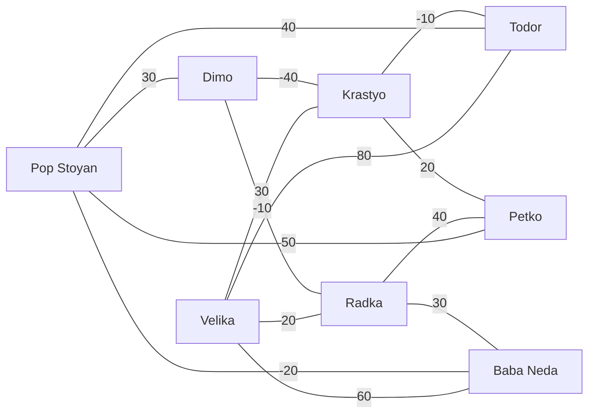

# Villagers (MVP)

Status: canon v0.1 · all characters **[I]**. Back to [GDD](../GDD.md) · systems: [villagers](../systems/villagers.md), [mysteries](../systems/mysteries.md).

Eight named villagers live in Mrak in the Unclean Days of 1834–35. Relationship values are the
starting `affinity` (−100 hostile … +100 devoted) used by [villagers](../systems/villagers.md).
Mystery references point to [mysteries.md](mysteries.md) (M1 = _The Wasting Bride_).

---

### 1. Pop Stoyan — village priest

- **Age / trade:** 54 · parish priest (married, as Orthodox parish priests are), also teaches letters.
- **Fears:** that God has abandoned Mrak; the Bishop's Greek clergy taking the parish from him.
- **Relationships:** Baba Neda (−20, "superstition"), Dimo (+30, his patron), Todor (+40, pupil), the guardian (+20).
- **Secret:** he accepts silver from Zlatno "for the church roof" — and knows it is hush money for the
  tithe-burials he does not record.
- **Role in mysteries:** M1 witness (the bell at 3:33); M2 holds the burial register.
- **Gameplay:** unlocks Liturgy training, the chapel building, holy water.

### 2. Baba Neda — midwife and herb-woman

- **Age / trade:** 71 · znaharka: midwife, healer, charms off the evil eye.
- **Fears:** fire; being called a witch "like the one before".
- **Relationships:** Velika (+60, delivered her), Pop Stoyan (−20), Radka (+30), Rada Svetleva (+70, apprentice).
- **Secret:** she knows where Stana's ashes were buried; her grandmother was there in 1779.
- **Role in mysteries:** M1 **prime false suspect** — her protective charm is found on Velika. Accusing her repeats Stana's fate.
- **Gameplay:** herbalist's hut, Znaharka mentor, lead-pouring rite.

### 3. Chorbadzhi Dimo — the headman

- **Age / trade:** 47 · kmet and chorbadzhiya: collects the taxes for the aga, owns the best fields.
- **Fears:** the aga's displeasure; debt; the dark (sleeps with a lamp lit).
- **Relationships:** Kostadin Zlatev (+50, creditor), Pop Stoyan (+30), Krastyo (−40, unpaid mill dues), Radka (−10).
- **Secret:** deep in debt to Zlatno; on Kostadin's orders he buried the _magiya_ under Velika's threshold.
- **Role in mysteries:** **M1 culprit.**
- **Gameplay:** tax events, link to the aga.

### 4. Velika — weaver, bride-to-be

- **Age / trade:** 19 · weaver of _cherga_ rugs; engaged to Todor, wedding set for Theophany.
- **Fears:** deep water (her brother drowned); being left alone.
- **Relationships:** Todor (+80), Baba Neda (+60), Radka (+20), Krastyo (+30, a secret friendship).
- **Secret:** she has been meeting Krastyo at night — not as lovers: he teaches her to read the
  Glagolitic carvings at the mill, which she has dreamt of since childhood.
- **Role in mysteries:** M1 **victim** — possessed by Mamnik.

### 5. Krastyo — the miller

- **Age / trade:** 33 · runs the watermill on the river below the forest.
- **Fears:** the mill wheel "talking"; the aga's men seizing the mill for unpaid dues.
- **Relationships:** Dimo (−40), Velika (+30), Petko (+20), Todor (−10, jealous of his schooling).
- **Secret:** mills are unclean places in folk belief, and he _has_ heard a voice in the wheel: it told
  him where to find old carvings under the mill floor (Thracian, not Glagolitic).
- **Role in mysteries:** M1 **false suspect** (seen near Velika's house at night, flour on her sill).
- **Gameplay:** flour → food; mill zone night variant.

### 6. Radka — tavern keeper

- **Age / trade:** 41 · widow, runs the _mehana_ (tavern) and the village's only inn room.
- **Fears:** the zaptiye / aga's men discovering who sleeps in her loft.
- **Relationships:** Baba Neda (+30), Dimo (−10), Velika (+20), Petko (+40).
- **Secret:** she is a _yatak_ — she shelters haiduti and passes them food and news.
- **Role in mysteries:** M1 **false suspect** (quarrelled with Velika's mother over a debt; owns the
  rope found at the well). M2 ally (haiduti know the mine paths).
- **Gameplay:** rumours board, trader visits, haidut contacts.

### 7. Petko — sexton and gravedigger

- **Age / trade:** 60 · _klisar_ (church sexton), rings the bell, digs the graves.
- **Fears:** the 40-day dead; that he rang the 3:33 bell in his sleep.
- **Relationships:** Pop Stoyan (+50), Radka (+40), Krastyo (+20), the guardian (+10).
- **Secret:** in 1829 he reburied three "plague dead" from Zlatno at night for silver — the graves were empty.
- **Role in mysteries:** M1 **key witness** (saw Dimo at the crossroads at midnight); **M2 suspect.**
- **Gameplay:** cemetery, bell tower, burial rites.

### 8. Todor — the young teacher

- **Age / trade:** 26 · _daskal_ of the cell school (_kiliyno uchilishte_) in the church annex; dreams of a real school.
- **Fears:** losing Velika; being thought a fool for believing in "peasant superstition".
- **Relationships:** Velika (+80), Pop Stoyan (+40), Krastyo (−10), Dimo (+0).
- **Secret:** keeps books that would anger both the Greek bishop and the aga's clerk, and a letter
  from a revolutionary committee in Bucharest he has not answered.
- **Role in mysteries:** M1 **ally** (keeps the deduction board honest; mistrusts the occult).
  Becomes the first sceptic voice; can turn to hysteria if Velika dies.
- **Gameplay:** school building (full game), Lore/Investigation training.

---

## Relationship graph (starting)

## Off-village NPCs (MVP)

- **Hasan Aga** — the local aga (landholder and tax authority) who lives in a konak a half-day away.
  Pragmatic, pressed by Plovdiv for revenue, tolerant while order holds. His household also
  consults Baba Neda for fevers — folk medicine crossed faith lines [F]. Never a caricature.
- **The Rival** — Yoana Zlateva of Zlatno (see [zlatno-bloodline](zlatno-bloodline.md)).
- **The Stranger** — a traveller at the crossroads (the Horned One).
- **The Forest Spirit** — "the one in the forest" (Stana).
