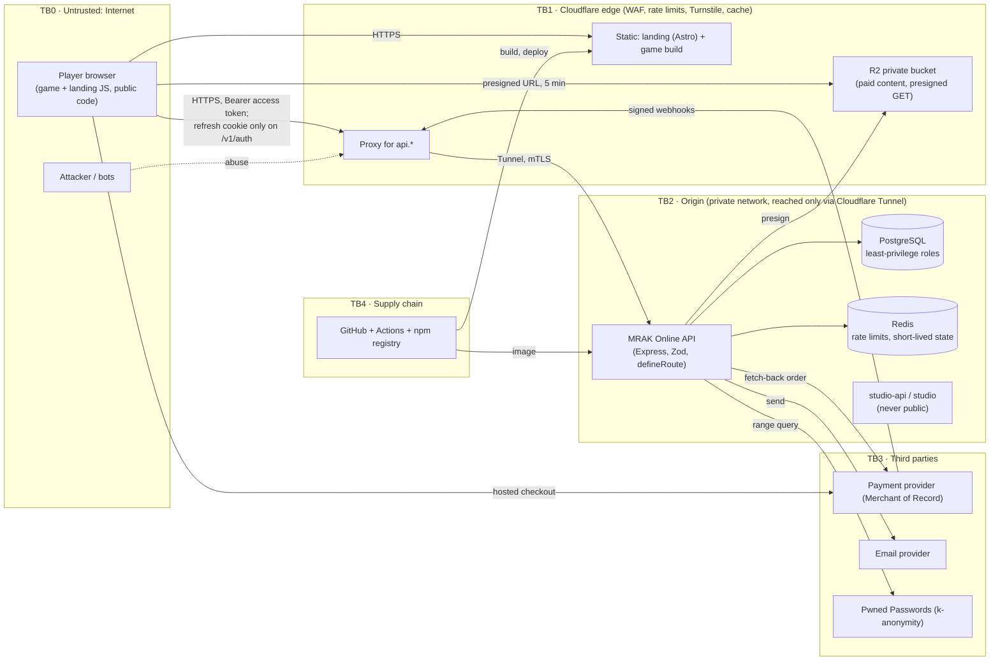

# Threat model — MRAK online platform

Status: v1.0 design (before the auth, payments and cloud-save code) · Owner: security · Review: on
every change to auth, rate limits, payments, permissions or data flows (CLAUDE.md) and at least
quarterly. Related: [ASVS L2 checklist](asvs-checklist.md) · [API Top 10](api-top10.md) ·
[data inventory](data-inventory.md) · ADRs [0007 tokens](../adr/0007-tokens.md),
[0008 Cloudflare edge](../adr/0008-cloudflare-edge.md),
[0009 guest and account](../adr/0009-guest-and-account.md),
[0010 payments provider](../adr/0010-payments-provider.md).

**Assumptions.** Many users, some hostile; the browser game and landing are public code; attackers
automate (botnets, residential proxies, headless browsers) and some aim only to **make us pay**
(CPU, email, storage, egress, logs). Every mitigation below names how it is verified: a test
(`SEC-*`, planned unless marked ✅) or a verifiable configuration (`CFG`).

## 1. Assets

| Asset                                        | Why it matters                            |
| -------------------------------------------- | ----------------------------------------- |
| Accounts (email, password hash, sessions)    | Takeover, GDPR breach, resale of accounts |
| Entitlements and paid content (R2)           | Revenue; piracy                           |
| Cloud saves, account progress                | Player trust (never lose progress)        |
| Payment records (provider ids, no card data) | Fraud, chargebacks, tax obligations       |
| Signing keys (JWT, content packs), secrets   | Total compromise                          |
| Service budget (CPU, email, R2, logs)        | Economic denial of service                |
| Availability of API, game CDN, landing       | Reputation, revenue                       |

## 2. Actors

Anonymous visitor · guest player (no account, local data only) · registered player · verified
player · paying player · attacker (scripted, botnet, credential lists, stolen cards) · compromised
dependency/maintainer · insider/operator with dashboard access · payment provider · email
provider.

## 3. Architecture and trust boundaries

| Boundary             | Rule                                                                                                       |
| -------------------- | ---------------------------------------------------------------------------------------------------------- |
| TB0 → TB1            | Everything public goes through Cloudflare; nothing else resolves to an origin IP (C-01).                   |
| TB1 → TB2            | Origin has no public ingress; only the Tunnel reaches it (C-01). Edge headers are not trusted as identity. |
| Browser → API        | Client fully untrusted: Zod strict validation, authorization server-side, size limits.                     |
| API → PG/Redis       | Private network, TLS, per-service roles, no superuser at runtime (C-41).                                   |
| TB3 → API (webhooks) | Untrusted until signature, timestamp and fetch-back succeed (C-27).                                        |
| Internet → studio    | Not allowed (C-40).                                                                                        |
| TB4 → production     | Only reviewed, pinned, scanned artifacts (C-32, C-33).                                                     |

## 4. Controls catalogue

Every control has a verification. `SEC-*` tests live next to the code they protect
(`services/online-api/src/**/*.security.test.ts` unless noted); `CFG` checks are run by the CI job
`security-config` against staging and the IaC in `infra/` (Cloudflare as Terraform).

| ID   | Control                                                                                                                                                                                                                                                                                                                                          | Verification                                                                                                                                                                                                                         |
| ---- | ------------------------------------------------------------------------------------------------------------------------------------------------------------------------------------------------------------------------------------------------------------------------------------------------------------------------------------------------ | ------------------------------------------------------------------------------------------------------------------------------------------------------------------------------------------------------------------------------------ |
| C-01 | All public hostnames proxied by Cloudflare; origin reachable only through Cloudflare Tunnel (no public IP/ports).                                                                                                                                                                                                                                | CFG SEC-EDGE-01: probe to origin IP/ports times out; DNS records all `proxied=true` (Terraform plan check).                                                                                                                          |
| C-02 | Cloudflare WAF: managed ruleset + OWASP core ruleset on `api.*`; block non-JSON bodies on JSON routes.                                                                                                                                                                                                                                           | CFG SEC-EDGE-02: staging probe with SQLi/XSS payloads → 403 at edge.                                                                                                                                                                 |
| C-03 | Edge rate limits per IP+colo in `infra/cloudflare/main.tf`: `/v1/auth/*` 30/min, `/v1/telemetry` 30/min, checkout 10/min, whole API 600/min; WAF blocks compressed bodies and unknown methods; managed challenge on sign-up/recovery for high threat scores.                                                                                     | CFG: `infra/cloudflare` Terraform (`terraform plan` clean); SEC-EDGE-03 probe in staging ⏳; `tests/load/abuse.js` (k6) ⏳ run on staging.                                                                                           |
| C-04 | Turnstile required on register, forgot-password and resend-verification, and on login after 3 failures (account) or 12 (IP); server-side `siteverify` checks success, action and hostname; fails closed.                                                                                                                                         | ✅ `auth/auth.test.ts` "needs Turnstile…", "asks for Turnstile after 3 failures…"; `auth/units.test.ts` "Turnstile verification".                                                                                                    |
| C-05 | App limits (`src/limits`): sliding-window counters in Redis (atomic Lua) per IP, IP+email, email, user, session and install, configurable with `RATE_LIMITS`; 429 RFC 9457 + `Retry-After` + `RateLimit`/`RateLimit-Policy`. Redis down: auth policies fail closed (503), the rest fall back to per-instance memory — never unlimited.           | ✅ `limits/limits.test.ts` (one 429 per limit, Redis down, real Redis shared counter), `routes.test.ts` walks the OpenAPI and fails if an operation has no limit.                                                                    |
| C-06 | Anti-enumeration: register, resend, forgot return identical status/body whether the account exists (existing → "already registered" mail); login runs Argon2id against a dummy hash for unknown accounts; mails are sent off the request path.                                                                                                   | ✅ `auth/auth.test.ts` "answers the same…", "wrong password and unknown account look the same, in body and in time" (median ratio 0.5–2), reset "same answer for unknown emails".                                                    |
| C-07 | Argon2id m=19 456 KiB, t=2, p=1 (OWASP); passwords 12–128 code points; hashing behind a semaphore (8 running, 64 waiting, else 503).                                                                                                                                                                                                             | ✅ `auth/units.test.ts` "documented Argon2id parameters", "sheds load when hashing is saturated"; `auth/auth.test.ts` 129-char password → 422.                                                                                       |
| C-08 | Common/trivial password list + email local part check; optional Pwned Passwords k-anonymity range API (`Add-Padding`), fail-open.                                                                                                                                                                                                                | ✅ `auth/auth.test.ts` common/trivial/breached → 422; `auth/units.test.ts` "Have I Been Pwned (k-anonymity)".                                                                                                                        |
| C-09 | Progressive throttling per account (keyed email hash) and per IP hash: after 5 account failures (20 per IP) each failure blocks 2^(n−5) s, capped 15 min, 1 h window; success clears the account counter; no permanent lockout.                                                                                                                  | ✅ `auth/auth.test.ts` "blocks with Retry-After after 5, never permanently", "throttles one IP that tries many accounts".                                                                                                            |
| C-10 | Email verification (24 h single-use token, newest only) required for account progress now, cloud saves and purchases later; purge of unverified accounts after 7 days ⏳ (job).                                                                                                                                                                  | ✅ `auth/auth.test.ts` "verification tokens are single use and expire", "account progress needs a verified email"; purge job ⏳.                                                                                                     |
| C-11 | Email: per recipient 3/h and 10/day; global `EMAIL_DAILY_CAP` per UTC day with alerts at 50 %, 80 %, 100 % (log `alert: email-budget`); `emails` switch.                                                                                                                                                                                         | ✅ `limits/limits.test.ts` "emails off or over the daily budget"; `auth/auth.test.ts` "caps emails per recipient".                                                                                                                   |
| C-12 | Email trimmed + lower-cased, unique index; disposable-domain list including subdomains.                                                                                                                                                                                                                                                          | ✅ `auth/auth.test.ts` disposable → 422, `TAKEN@` = `taken@`; `auth/units.test.ts` subdomain match.                                                                                                                                  |
| C-13 | Access token: JWT EdDSA (Ed25519), `typ: at+jwt`, TTL 10 min, claims sub/sid/iat/exp/iss/aud/jti required, algorithms pinned to EdDSA, `kid` from the local JWKS (rotation ≤ 4 keys), session row checked on every request; client keeps it in memory ([ADR 0007](../adr/0007-tokens.md)).                                                       | ✅ `auth/auth.test.ts` "rejects expired, tampered, alg none, other alg, unknown kid and wrong iss/aud", JWKS without `d`; `auth/units.test.ts` rotation.                                                                             |
| C-14 | Refresh token: 256-bit random, stored as SHA-256, one family per session, sliding 30 days / absolute 90 days, rotated on every use with a conditional update; reuse revokes family + session, audit `refresh-reuse`, email.                                                                                                                      | ✅ `auth/auth.test.ts` "rotation changes the token; reusing the old one revokes the family…", "refresh fails after logout, after logout-all, when expired and past the absolute limit".                                              |
| C-15 | Refresh cookie `__Secure-mrak_rt`: HttpOnly, Secure, SameSite=Strict, Path=/v1/auth, Domain=mrak.game (shared by mrak.game, play., api.); cleared on logout/failed refresh/deletion. Native platforms get it in the body instead.                                                                                                                | ✅ `auth/auth.test.ts` "web login sets the refresh cookie with exact attributes", "native platforms get the refresh token in the body".                                                                                              |
| C-16 | CSRF: every `/v1/auth/*` POST requires `X-MRAK-CSRF: 1`; a present `Origin` must be allow-listed; cookie-bearing requests must send `Origin`. Other routes use Bearer only.                                                                                                                                                                      | ✅ `auth/auth.test.ts` "refuses requests without the CSRF header, from foreign origins, or cookies without Origin".                                                                                                                  |
| C-17 | CORS: exact origin allow-list (`CORS_ORIGINS`); credentials only on `/v1/auth`.                                                                                                                                                                                                                                                                  | ✅ `auth/auth.test.ts` "CORS allows only the exact origins, credentials only on /v1/auth".                                                                                                                                           |
| C-18 | Security headers on CDN (game, landing): strict CSP (`script-src 'self'` + hashes, no `unsafe-inline/eval`, `connect-src` API only, `frame-ancestors 'none'`), HSTS preload, `X-Content-Type-Options`, `Referrer-Policy: strict-origin-when-cross-origin` (`no-referrer` on reset page). API: `helmet` ✅.                                       | CFG SEC-HDR-18: CI checks the `_headers`/Cloudflare config and probes staging; CSP violation reports monitored.                                                                                                                      |
| C-19 | XSS hygiene: React escaping only; ESLint bans `dangerouslySetInnerHTML`, `innerHTML`, `eval`; user strings (display name) limited to 3–24 chars of a safe charset; content packs are data-only and signed ✅.                                                                                                                                    | SEC-XSS-19: lint rule fixture test; payload `` as display name rejected by schema and rendered inert.                                                                                                                   |
| C-20 | Strict Zod validation; JSON body 16 KB by default, per-route `bodyLimit` (cloud saves 2 MB), `Content-Length` > 2 MB refused before parsing.                                                                                                                                                                                                     | ✅ `app.test.ts` (16 KB → 413, 3 MB → 413), `routes.test.ts` (no route over 2 MB).                                                                                                                                                   |
| C-21 | No request decompression: `Content-Encoding` ≠ identity → 415 (also blocked at the edge); parsers run with `inflate: false`.                                                                                                                                                                                                                     | ✅ `auth/auth.test.ts` "refuses compressed bodies"; CFG WAF rule.                                                                                                                                                                    |
| C-22 | SQL only through Prisma; raw SQL only via tagged templates; ESLint bans `$queryRawUnsafe`/`$executeRawUnsafe`; runtime DB role has DML only on its own schema (no DDL, no superuser).                                                                                                                                                            | SEC-SQL-22: lint fixture; injection payloads in every string field round-trip as data; role privileges asserted in migration test.                                                                                                   |
| C-23 | Object-level authorization: user id only from the verified token, never from path/body/query; every query scoped by `userId`; resource ids random UUIDv4; cross-tenant access → 404.                                                                                                                                                             | SEC-AUTHZ-23: generated matrix — for every route, user B with user A's ids → 404/empty.                                                                                                                                              |
| C-24 | Timeouts and budgets: handler 10 s, headers 11 s, Postgres pool `DB_POOL_MAX` (10) with `statement_timeout` 5 s and connect timeout 3 s, Redis commands 500 ms (no offline queue), Turnstile 5 s, HIBP 2 s.                                                                                                                                      | ✅ timeout middleware tests; `server.ts` config; k6 `tests/load/abuse.js` thresholds ⏳ staging.                                                                                                                                     |
| C-25 | No enumeration surfaces: no public user directory, profiles or rankings; every list endpoint has a hard cap (OpenAPI `maxItems`) and cursor pagination.                                                                                                                                                                                          | SEC-API-25: OpenAPI lint — every array response has `maxItems`; route registry has no unauthenticated list of users.                                                                                                                 |
| C-26 | Telemetry: opt-in, separate route, fixed schema (enum event names, numeric fields), ≤ 50 events and ≤ 8 kB per batch, per-install + per-IP limits, server-side sampling, returns 202 and drops on overload, kill switch, no personal data, 90-day retention.                                                                                     | ✅ SEC-TEL-26 `telemetry/telemetry.test.ts`: unknown event/extra field/e-mail/URL → dropped; 51 events → 400; > 8 kB → 413; kill switch → 202 + nothing stored; game: no consent → nothing sent.                                     |
| C-27 | Payment webhooks: verify provider signature over the raw body (constant-time), timestamp tolerance 5 min, dedupe by event id (unique table), then fetch the order from the provider API before acting. Only provider IP ranges at the edge.                                                                                                      | ✅ `store/store.test.ts` (forged, other-key and stale signatures → 400; repeated event → `duplicate`, one row; order re-read from the provider API).                                                                                 |
| C-28 | Entitlements are granted only from verified webhooks (server-to-server); the client never asserts a purchase; paid content checks entitlements server-side ✅ (progress tiers).                                                                                                                                                                  | ✅ `store/store.test.ts` (checkout + return page grant nothing; order not `completed` → nothing).                                                                                                                                    |
| C-29 | Refund/chargeback webhooks revoke the entitlement, flag the account and block new purchases pending review.                                                                                                                                                                                                                                      | ✅ `store/store.test.ts` (refund → revoked, full pack 403; chargeback → `purchases_blocked`).                                                                                                                                        |
| C-30 | Purchase velocity: checkout sessions per account 5/h and per IP 10/h; Merchant of Record fraud screening + 3-D Secure ([ADR 0010](../adr/0010-payments-provider.md)).                                                                                                                                                                            | ✅ `store/store.test.ts` SEC-PAY-30 (6th checkout → 429); consent checkbox required; CFG: provider fraud rules and 3DS (dashboard export reviewed) ⏳.                                                                               |
| C-31 | Paid content: private R2 bucket (Terraform, no public domain); SigV4 presigned GET for one object, ≤ 5 min (`src/content/presign.ts`); `POST /v1/content/full` checks the entitlement, 30/day per account; the public build ships only demo content (`splitByTier`, CI `check:demo`).                                                            | ✅ `store/store.test.ts` (no entitlement → 403; signed URL expires after 300 s or when tampered; R2 `X-Amz-Expires=300`); CI `check:demo` (public build contains no full-tier content).                                              |
| C-32 | Supply chain: frozen lockfile, exact versions, new versions only after ≥ 7 days (Renovate `minimumReleaseAge`), install scripts only for allowlisted packages (`onlyBuiltDependencies`), `pnpm audit --prod` gate (high/critical), Actions pinned by SHA, `GITHUB_TOKEN` read-only default, CycloneDX SBOM per release.                          | CFG SEC-SC-32: CI job fails on unpinned action, missing lockfile, audit findings; SBOM artifact present.                                                                                                                             |
| C-33 | Secrets: gitleaks pre-commit + CI ✅; secrets only in the platform secret store; env validated at startup ✅; built bundles scanned for secret patterns; key rotation runbook (JWT, pack signing, webhook, provider keys).                                                                                                                       | ✅ gitleaks CI; SEC-SEC-33: `dist/` scan job; startup refuses missing secrets.                                                                                                                                                       |
| C-34 | Logging: redaction of Authorization, cookies, passwords, tokens ✅; emails masked; append-only security audit log (login ok/fail, reset, token reuse, email change, deletion, purchase, refund) with request id and actor; 30-day app logs, 1-year audit log.                                                                                    | ✅ logger redaction test; SEC-LOG-34: each audited action writes one row; no full email in any log line (grep test).                                                                                                                 |
| C-35 | Password reset: 256-bit token stored hashed, single use, TTL 30 min, only the newest valid; link from `APP_URL` with the token in the fragment; success revokes all sessions, emails the user, never signs in.                                                                                                                                   | ✅ `auth/auth.test.ts` "password reset: single-use, expiring, revokes sessions, never signs in…".                                                                                                                                    |
| C-36 | Re-authentication with the current password (throttled like login) for password change and account deletion; email change not offered yet.                                                                                                                                                                                                       | ✅ `auth/auth.test.ts` "changing the password needs the current one…", deletion with wrong password → 401.                                                                                                                           |
| C-37 | Account deletion: password + `confirm: "DELETE"`; immediate hard delete of user, sessions, tokens, email tokens and every registered data hook (progress; saves later); audit rows kept with `userId` null; entitlement rows are kept pseudonymized (order reconciliation with the merchant of record), collector names are erased.              | ✅ `auth/auth.test.ts` "exports the account and deletes every trace of it".                                                                                                                                                          |
| C-38 | Cloud saves: owner = signed-in verified account (no user id in paths), slots `slot-1..3` (1 version) + `auto` (3 versions), payload ≤ 1.5 MB, body ≤ 2 MB, SHA-256 integrity, `format: mrak-save`, `If-Match`/`If-None-Match` optimistic concurrency (412 / 428), 30 uploads/h per user, `cloud-saves` switch; ≤ 10 active sessions per account. | ✅ `saves/saves.test.ts` (conflict, IDOR, quotas, integrity, size, switch, rate limit, deletion), `apps/game/src/storage/cloud-sync.test.ts` (two devices, offline, conflicts, guest migration), `limits/limits.test.ts` (sessions). |
| C-39 | Cost guardrails: emergency switches (registration, cloud-saves, telemetry, emails, purchases) in Redis, no deploy; email budget; API autoscaling ceiling 4 instances; Cloudflare DDoS/tunnel alerts; provider budget alerts at 50/80 %; unverified accounts purged after 7 days.                                                                 | ✅ `limits/limits.test.ts` (switches → 503, real-Redis flip, purge); CFG `infra/cloudflare` alerts; provider budgets per [runbook](../runbooks/abuse.md).                                                                            |
| C-40 | studio-api and studio bound to private network only ✅ (Docker ports on 127.0.0.1).                                                                                                                                                                                                                                                              | CFG SEC-EDGE-40: no DNS record or tunnel route for studio; external probe fails.                                                                                                                                                     |
| C-41 | Postgres and Redis on the private network, TLS, password/ACL, separate roles/logical DBs per service ✅ (docker-compose).                                                                                                                                                                                                                        | CFG SEC-INF-41: connection without TLS/credentials refused; role grants test.                                                                                                                                                        |
| C-42 | Logout revokes the session and clears the cookie; logout-all revokes all; `GET /me/sessions` lists platform and times (no IP); `DELETE /me/sessions/:id` only for own sessions (else 404).                                                                                                                                                       | ✅ `auth/auth.test.ts` "lists sessions and cannot revoke another user’s session (IDOR)", logout tests.                                                                                                                               |
| C-43 | Operator access: SSO + MFA on Cloudflare, payment, email, hosting and database consoles; least privilege; quarterly access review.                                                                                                                                                                                                               | CFG SEC-OPS-43: access review checklist signed each quarter; MFA enforcement exported from each console.                                                                                                                             |
| C-44 | In-game bug reports: no account, contact or IP stored; strict schema (version, platform, ≤ 2 000-char text); save + seed only together and only with the player's consent box; ≤ 1 MB body; 10/h per IP; 90-day retention.                                                                                                                       | ✅ SEC-BUG-44 `bugs/bugs.test.ts`: extra field → 400; seed without save → 400; > 1 MB → 413; 11th report/h → 429; purge.                                                                                                             |

## 5. STRIDE per component

| Component            | Spoofing              | Tampering            | Repudiation | Information disclosure        | Denial of service                 | Elevation of privilege |
| -------------------- | --------------------- | -------------------- | ----------- | ----------------------------- | --------------------------------- | ---------------------- |
| Landing (Astro, CDN) | C-18 (clickjack)      | C-32, C-18 (CSP)     | —           | C-18                          | C-01, C-03 (cache)                | C-43 (deploy access)   |
| Game (static, CDN)   | C-18                  | C-32, C-33           | —           | C-13 (tokens in memory), C-19 | C-01                              | —                      |
| Cloudflare edge      | C-43                  | C-43 (config as IaC) | C-34        | C-31                          | C-02, C-03                        | C-43                   |
| MRAK Online API      | C-13, C-14, C-04      | C-20, C-21, C-22     | C-34        | C-06, C-23, C-25              | C-05, C-07, C-24, C-39            | C-23, C-28, C-36       |
| PostgreSQL           | C-41                  | C-22                 | C-34        | C-41, C-37                    | C-24                              | C-22 (role), C-41      |
| Redis                | C-41                  | C-41                 | —           | C-41 (no PII stored)          | C-24 (fail-closed on auth limits) | C-41                   |
| Payment provider     | C-27                  | C-27                 | C-34        | C-30 (no card data, SAQ A)    | C-30                              | C-28                   |
| Email provider       | C-43 (SPF/DKIM/DMARC) | —                    | C-34        | C-34 (masked)                 | C-11                              | C-43                   |
| R2 (paid content)    | C-31                  | C-43                 | C-34        | C-31                          | C-31, C-39                        | C-31                   |
| Telemetry ingestion  | C-26                  | C-26                 | —           | C-26                          | C-26, C-39                        | —                      |
| CI / supply chain    | C-43                  | C-32                 | C-32 (SBOM) | C-33                          | —                                 | C-32                   |

Redis outage policy: auth and payment rate limits **fail closed** (503), read-only routes fail open
with the in-process limiter (SEC-RL-05 covers both).

Email DNS: SPF, DKIM and DMARC `p=reject` on the sending domain (CFG SEC-MAIL-DNS, checked by a DNS
probe in `security-config`).

## 6. STRIDE per flow

Each row: threat → controls. Tests are those of the controls (section 4).

### Registration

| STRIDE | Threat                                         | Controls                     |
| ------ | ---------------------------------------------- | ---------------------------- |
| S      | Bots create accounts in bulk                   | C-04, C-03, C-05, C-10, C-12 |
| T      | Extra fields (roles, entitlements) in the body | C-20                         |
| R      | User denies creating the account               | C-34                         |
| I      | "Email already registered" reveals accounts    | C-06                         |
| D      | Argon2 CPU exhaustion; verification email cost | C-07, C-11, C-39             |
| E      | Weak or breached password                      | C-07, C-08                   |

### Email verification

| STRIDE | Threat                                  | Controls                                                     |
| ------ | --------------------------------------- | ------------------------------------------------------------ |
| S      | Guessing verification tokens            | 256-bit hashed single-use token, TTL 24 h (C-35 rules), C-05 |
| T      | Verifying someone else's address        | Token bound to account + address                             |
| R      | —                                       | C-34                                                         |
| I      | Token in logs/Referer                   | C-34, C-18 (`no-referrer`)                                   |
| D      | Resend used for email bombing           | C-04, C-11                                                   |
| E      | Unverified account using gated features | C-10                                                         |

### Login

| STRIDE | Threat                            | Controls                     |
| ------ | --------------------------------- | ---------------------------- |
| S      | Credential stuffing, brute force  | C-04, C-05, C-09, C-08, C-03 |
| T      | —                                 | C-20                         |
| R      | "It wasn't me"                    | C-34 (+ new-device email)    |
| I      | Enumeration by message or timing  | C-06                         |
| D      | Hash flooding; lockout of victims | C-07, C-09 (no hard lockout) |
| E      | Session fixation                  | New family per login (C-14)  |

### Refresh

| STRIDE | Threat                      | Controls   |
| ------ | --------------------------- | ---------- |
| S      | Stolen refresh token reused | C-14, C-15 |
| T      | Forged JWT                  | C-13       |
| R      | —                           | C-34       |
| I      | Token readable by JS        | C-15, C-13 |
| D      | Refresh flooding            | C-05, C-03 |
| E      | CSRF to mint tokens         | C-16, C-17 |

### Logout

| STRIDE | Threat                           | Controls                |
| ------ | -------------------------------- | ----------------------- |
| S      | Forced logout via CSRF           | C-16                    |
| T      | Token remains valid after logout | C-42, C-13 (10 min TTL) |
| R      | —                                | C-34                    |
| I      | —                                | —                       |
| D      | —                                | C-05                    |
| E      | —                                | —                       |

### Password reset

| STRIDE | Threat                                             | Controls          |
| ------ | -------------------------------------------------- | ----------------- |
| S      | Account takeover with a guessed/leaked reset token | C-35, C-05        |
| T      | Host header poisoning of the reset link            | C-35              |
| R      | —                                                  | C-34              |
| I      | Reset reveals account existence                    | C-06              |
| D      | Email bombing of a victim                          | C-04, C-11        |
| E      | Attacker sessions survive the reset                | C-35 (revoke all) |

### Account deletion

| STRIDE | Threat                                 | Controls                  |
| ------ | -------------------------------------- | ------------------------- |
| S      | Deletion by a hijacked session         | C-36, C-37 (grace + mail) |
| T      | —                                      | C-20                      |
| R      | User disputes deletion                 | C-34                      |
| I      | Data left behind after deletion        | C-37                      |
| D      | Mass deletion requests                 | C-05                      |
| E      | Deleting another user's account (IDOR) | C-23                      |

### Cloud save

| STRIDE | Threat                            | Controls                                                            |
| ------ | --------------------------------- | ------------------------------------------------------------------- |
| S      | Writing to another account's slot | C-23, C-13                                                          |
| T      | Malicious save payload            | C-20, C-21, C-38 (opaque, checksummed; client validates on load ✅) |
| R      | "My save was overwritten"         | C-38 (revisions), C-34                                              |
| I      | Reading another account's save    | C-23                                                                |
| D      | Storage exhaustion, giant uploads | C-38, C-20, C-39                                                    |
| E      | —                                 | C-23                                                                |

### Achievements and account progress

| STRIDE | Threat                                                   | Controls                                         |
| ------ | -------------------------------------------------------- | ------------------------------------------------ |
| S      | Unauthenticated writes                                   | C-13 (401 ✅ `progress.test.ts`)                 |
| T      | Forged unlocks (accepted risk: no advantage, no ranking) | Catalog + tier checks ✅, C-25 (no public lists) |
| R      | —                                                        | Idempotent rows with timestamps ✅               |
| I      | Reading others' progress                                 | C-23                                             |
| D      | Row flooding                                             | ✅ 6000 rows/account, ≤ 50 per batch, C-05       |
| E      | Full-tier ids without purchase                           | ✅ entitlement check, C-28                       |

### Purchase and payment webhooks

| STRIDE | Threat                                                  | Controls                                                         |
| ------ | ------------------------------------------------------- | ---------------------------------------------------------------- |
| S      | Forged webhook grants content                           | C-27                                                             |
| T      | Price/product tampering in the client                   | Prices only from provider catalog server-side; fetch-back (C-27) |
| R      | Buyer denies purchase                                   | C-34, provider records                                           |
| I      | Card data exposure                                      | Hosted checkout; no card data touches us (C-30)                  |
| D      | Webhook replay flood                                    | C-27 (dedupe), C-03                                              |
| E      | Grant via client redirect; keep access after chargeback | C-28, C-29                                                       |

### Paid content download

| STRIDE | Threat                         | Controls                            |
| ------ | ------------------------------ | ----------------------------------- |
| S      | Download without entitlement   | C-31, C-28                          |
| T      | Modified content pack          | Ed25519-signed packs ✅ (section 8) |
| R      | —                              | C-34                                |
| I      | Shared or leaked links         | C-31                                |
| D      | Egress/operation cost attacks  | C-31, C-39                          |
| E      | Bucket listing / public access | C-31                                |

### Telemetry

| STRIDE | Threat                                  | Controls                                  |
| ------ | --------------------------------------- | ----------------------------------------- |
| S      | Fake installs inflate data              | C-26 (accepted: analytics only)           |
| T      | Schema abuse to store arbitrary data    | C-26                                      |
| R      | —                                       | —                                         |
| I      | Personal data collected by accident     | C-26, [data inventory](data-inventory.md) |
| D      | Volume flood to raise storage/log costs | C-26, C-39, C-03                          |
| E      | —                                       | —                                         |

## 7. Mandatory threat register

Every threat has at least one mitigation and one planned verification.

| #    | Threat                                                      | Mitigations                                                     | Verification                                           |
| ---- | ----------------------------------------------------------- | --------------------------------------------------------------- | ------------------------------------------------------ |
| T-01 | Credential stuffing                                         | C-04, C-08, C-09, C-05, C-03, new-device mail                   | SEC-AUTH-04, SEC-AUTH-08, SEC-AUTH-09, CFG SEC-EDGE-03 |
| T-02 | Brute force (online)                                        | C-09, C-05, C-07                                                | SEC-AUTH-09, SEC-RL-05                                 |
| T-03 | Account enumeration                                         | C-06, C-25                                                      | SEC-AUTH-06, SEC-API-25                                |
| T-04 | Mass registration by bots                                   | C-04, C-03, C-05, C-10, C-12                                    | SEC-AUTH-04, SEC-AUTH-10, SEC-AUTH-12                  |
| T-05 | Email bombing                                               | C-11, C-04, C-05                                                | SEC-MAIL-11                                            |
| T-06 | Refresh token theft and reuse                               | C-14, C-15, C-42                                                | SEC-TOK-14, SEC-TOK-15, SEC-TOK-42                     |
| T-07 | XSS                                                         | C-18, C-19, C-13 (no tokens in storage)                         | CFG SEC-HDR-18, SEC-XSS-19, SEC-TOK-13                 |
| T-08 | CSRF                                                        | C-16, C-17, C-15                                                | SEC-CSRF-16, SEC-CORS-17                               |
| T-09 | SQL injection                                               | C-22, C-20, C-02                                                | SEC-SQL-22, CFG SEC-EDGE-02                            |
| T-10 | IDOR / BOLA                                                 | C-23                                                            | SEC-AUTHZ-23                                           |
| T-11 | Giant files / bodies                                        | C-20, C-38, edge max body 1 MB                                  | SEC-IN-20, SEC-SAVE-38, CFG SEC-EDGE-03                |
| T-12 | Compression bombs                                           | C-21                                                            | SEC-IN-21                                              |
| T-13 | Layer-7 DDoS                                                | C-01, C-02, C-03, C-05, C-24, C-39, runbook "Under Attack mode" | CFG SEC-EDGE-01/03, SEC-DOS-24, CFG SEC-COST-39        |
| T-14 | Scraping                                                    | C-25, C-03, C-31 (random ids, no listing)                       | SEC-API-25, SEC-DL-31                                  |
| T-15 | Telemetry abuse                                             | C-26, C-39                                                      | SEC-TEL-26                                             |
| T-16 | Forged payment webhooks                                     | C-27                                                            | SEC-PAY-27                                             |
| T-17 | Sharing paid content links                                  | C-31                                                            | SEC-DL-31                                              |
| T-18 | Card fraud and chargebacks                                  | C-30, C-29, C-10                                                | SEC-PAY-29, SEC-PAY-30                                 |
| T-19 | Compromised dependencies                                    | C-32                                                            | CFG SEC-SC-32                                          |
| T-20 | Secret leakage                                              | C-33, C-34                                                      | gitleaks ✅, SEC-SEC-33, SEC-LOG-34                    |
| T-21 | Account takeover via password reset                         | C-35, C-36, C-06, C-11                                          | SEC-RST-35, SEC-REAUTH-36                              |
| T-22 | Cost attacks (CPU, email, storage, egress, logs)            | C-07, C-11, C-26, C-31, C-38, C-39                              | SEC-AUTH-07, SEC-MAIL-11, SEC-TEL-26, CFG SEC-COST-39  |
| T-23 | Studio exposed to the internet                              | C-40                                                            | CFG SEC-EDGE-40                                        |
| T-24 | Bug-report abuse (spam, storage, personal data in the text) | C-44, C-39, C-03                                                | SEC-BUG-44                                             |

## 8. Controls already in place

- `helmet`, `x-powered-by` disabled; JSON body limit 16 kB; request timeout 10 s (handler) and
  `server.requestTimeout`.
- Every route declares a rate limit via `defineRoute`; `routes.test.ts` fails otherwise.
- Logger redacts `Authorization`, cookies, `set-cookie`, passwords and tokens.
- Environment validated with Zod at startup; raw values are never logged.
- Secret scanning: gitleaks in pre-commit and CI. Docker ports published on `127.0.0.1` only.
- `GET /v1/seasonal` (public, read-only, no personal data): 30 req/min per client,
  `Cache-Control: public, max-age=300`. The server clock is authoritative for online rewards; the
  client re-checks every id against its own content windows, so a forged reply can at most
  activate an event the content already places on that date.
- Live content packs: data only, never code. The client checks size (≤ 2 MB), SHA-256 and an
  Ed25519 signature (public key in the build) before parsing with a strict schema; packs may only
  add new ids and locale keys (tests: `apps/game/src/host/live-content.test.ts`).
- Account progress (`/v1/achievements*`, `/v1/progress`): forgeable by design and accepted (no
  advantage, no money, no ranking). Account required (authenticator injected in code; 401 until
  accounts exist), per-route limits, ≤ 50 items per batch, ids checked against the content
  catalog, `full`-tier ids need the `full-game` entitlement, Legacy ≤ 1000 per award, future times
  clamped, ≤ 6000 rows per account (also the read cap), idempotent on (user, kind, key). Tests:
  `services/online-api/src/routes/progress.test.ts`.

## 9. Accepted risks

- Single-player data (saves, achievements, progress) can be forged by the client: no competitive
  or monetary value, no public rankings.
- Telemetry can be polluted by fake installs: analytics only, never billing or rewards.
- Determined pirates can re-share paid content once downloaded: mitigated to "costly and
  traceable", not prevented (C-31).

## 10. Open items

- Accounts are implemented (`services/online-api/src/auth`, tests in `src/auth/*.test.ts`,
  coverage gate in `vitest.config.ts`). Pending: real email provider, unverified-account purge
  job, Prisma repository integration tests against Postgres, Redis-backed rate-limit test.
- Implement cloud saves, payments, downloads and telemetry against this model;
  each PR links the controls it implements and their `SEC-*` tests.
- Cursor pagination (list endpoints are capped at 6000 rows, no cursor yet).
- Legacy spent on Bloodline nodes is not reconciled server-side against Legacy awarded.
- Pack signing key rotation: one key per build for now.
- Create the `security-config` CI job and `infra/` Cloudflare Terraform referenced by `CFG` checks.
