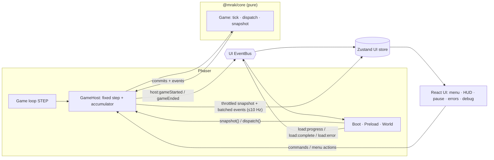

# Game app (apps/game)

Status: v1 · MVP: ✅ · Package: `apps/game` · Back to [GDD](../GDD.md) · [index](README.md) ·
decisions: [ADR 0001](../adr/0001-phaser-react-browser.md), [ADR 0004](../adr/0004-pure-core.md) ·
assets: [asset-pipeline](asset-pipeline.md)

## Purpose

The browser shell: Phaser renders the world, React renders the UI, and both talk to the pure
core `Game` only through narrow, typed bridges.

## Architecture

| Piece         | File                     | Role                                                                                                                                                                                                                                                                                                                  |
| ------------- | ------------------------ | --------------------------------------------------------------------------------------------------------------------------------------------------------------------------------------------------------------------------------------------------------------------------------------------------------------------- |
| `GameHost`    | `src/host/GameHost.ts`   | Owns the core `Game`; fixed 30 Hz step with an accumulator (≤ 5 steps/frame, backlog dropped after a hitch); pause reasons (`focus`, `menu`, `loading`); save/load/continue; autosave at dawn and dusk; pushes snapshots to the store at most every 100 ms (immediately after player commands). No Phaser dependency. |
| Phaser bridge | `src/game/services.ts`   | Services (host, bus, assets, store) live in the Phaser **registry** of that game instance (set in `callbacks.preBoot`) — no globals. Scenes read `host.snapshot()` and send `host.dispatch()`.                                                                                                                        |
| React bridge  | `src/state/*`            | Zustand vanilla store + `useUi(selector)`; components subscribe to slices, so a snapshot update re-renders only what changed.                                                                                                                                                                                         |
| UI EventBus   | `src/events/EventBus.ts` | Presentation signals only (loading, scene ready, game started/ended). Game rules stay in core.                                                                                                                                                                                                                        |
| Content       | `src/host/content.ts`    | Bundles `packages/content/data/**` and validates it with the same validator as CI before building the `ContentDatabase`.                                                                                                                                                                                              |

## Scenes

- **Boot** — loads `assets/manifest.json` (no-cache) → Preload.
- **Preload** — loads the base group (`common`) behind fog and a candle; React shows progress
  and rotating tips at native resolution; then stays as the backdrop of the React main menu.
- **MainMenu** — React: Continue, New Game, Load, Options, Achievements, Account, Quit to site.
- **World** — lazily loads the zone's asset groups (sim paused meanwhile), draws the zone
  (placeholder layout until Tiled maps), guardian movement, darkness overlay with the lantern
  light by day phase; walking off an edge dispatches `enterZone` and restarts the scene.

## Rules

1. Core is advanced only by `GameHost.update(delta)` from Phaser's `STEP` event.
2. React never re-renders per frame: the store changes at most ~10 times a second.
3. **Scaling:** 640×360 base, `Scale.NONE` + `MAX_ZOOM` (largest integer zoom), recomputed on
   resize; letterbox is a dark vignette; the canvas rect is published as CSS variables
   (`--game-left/top/width/height`) so the HUD aligns to the game while its text renders at native
   resolution.
4. **Focus:** Phaser `BLUR`/`HIDDEN` pause the game (option, on by default); one click or key resumes.
   Escape opens the pause menu.
5. **Audio:** Phaser unlocks Web Audio on the first gesture; until then a hint is shown.
6. **Errors:** WebGL is checked before Phaser starts; missing WebGL, failed asset loads and invalid
   content show a friendly, localized error screen with "Try again".
7. **Saves:** IndexedDB (memory fallback in private mode); slots `auto`, `slot-1..3`.
8. **Account:** UI only; online-api auth does not exist yet and the form says so. Tokens will live in
   memory / HttpOnly cookies — never in storage.
9. **Debug console (F1):** development builds only (lazy import behind `import.meta.env.DEV`, absent
   from production bundles). Flags, global and villager stats, time skips, forced director events,
   event log, fps — all through core commands.
10. All player-facing text is in `locales/en.json`.

## Measured (2026-11-15)

Lighthouse 13.6, desktop preset, devtools throttling 20 Mbps / 40 ms RTT, local `vite preview`:
total download **501 KiB**, user timing `mrak:menu-ready` **0.74 s**, performance score 96.
Without audio (ffmpeg was unavailable locally); the wind loop adds well under 200 KiB.

## Test ideas

- GameHost: fixed steps and remainder carry-over; step cap after a hitch; store updates ≤ 11/s at
  60 fps; player actions visible immediately; pause reasons combine; save → quit → continue;
  autosave at dusk (implemented in `src/host/GameHost.test.ts`).
- Content bundle validates; raw-pack mapping; options and save storage fallbacks
  (`content.test.ts`, `storage.test.ts`).
- Manual / E2E (to automate with Playwright): menu → new game → walk to the forest (zone assets
  load lazily) → debug "to night" shows darkness → Escape → save → quit → continue restores the time;
  no console errors; WebGL disabled shows the error screen; Chrome, Firefox, Safari desktop.
